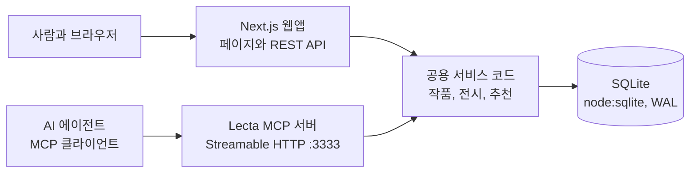

# Lecta 1차 스프린트 리뷰와 UAT

> **A living exhibition of what you love, and why.**
> Lecta는 좋아하는 영화와 시리즈, 책과 앨범을 골라 왜 좋았는지 한 줄씩 남기면 그것들이 하나의 전시실이 되는 서비스입니다. Lecta는 그 방을 읽고 벽에 걸릴 다음 작품을 찾아 주며, 같은 기능을 사람뿐 아니라 AI 에이전트도 MCP를 통해 직접 사용할 수 있습니다.

| 항목 | 내용 |
| --- | --- |
| 팀 | THE GLEANERS (4명) |
| 일정 | 10월 31일 1차 발표와 UAT, 11월 14일 중간발표, 12월 19일 최종 데모 |
| 코드 | `github.com/yerielk/LT_THEGLEANERS`의 `feat/uat-editorial-mcp` 브랜치 (main에는 아직 병합하지 않음) |
| 함께 보는 문서 | 예상 질문은 `docs/Lecta_예상질문.md`, 시연 대본은 `UAT_DEMO.md`, 기술 상세는 `README.md` |

---

## 1. 우리가 풀려는 문제

영화는 왓챠피디아나 Letterboxd에, 책은 독서 앱에, 음악은 스트리밍 서비스에 기록이 흩어져 있어서, 한 사람의 취향이 실제로는 하나로 이어져 있는데도 그 연결을 어디에서도 볼 수 없습니다. 게다가 남는 기록은 대부분 별점과 시청 이력이라서 무엇을 좋아했는지는 남아도 왜 좋아했는지는 금방 사라집니다. AI에게 추천을 부탁할 때도 같은 문제가 생기는데, 에이전트는 사용자의 실제 기록을 볼 수 없기 때문에 매번 취향을 처음부터 다시 설명해야 합니다.

Lecta는 매체를 가로질러 작품을 모아 하나의 전시로 큐레이션하게 하고, 작품마다 고른 이유를 한 줄씩 쌓게 합니다. 이렇게 쌓인 전시의 맥락을 근거로 다른 매체의 작품을 추천하고, 같은 데이터와 추천 기능을 MCP 서버로 열어서 사용자가 허락한 범위 안에서는 외부 AI 에이전트도 Lecta를 직접 쓸 수 있게 합니다.

## 2. 기존 서비스와 무엇이 다른가

| 서비스 | 다루는 매체 | 중심 경험 | 추천과 AI | 소셜 | Lecta와의 차이 |
| --- | --- | --- | --- | --- | --- |
| Letterboxd | 영화 중심 (2023년에 TV 추가 계획을 밝혔으나 전면 도입은 확인되지 않음) | 감상 일지, 별점, 리뷰, 리스트, 유료 통계 | 사용자 리스트와 커뮤니티 중심 | 팔로우와 활동 피드, 회원 1,700만 명 이상(2024) | 한 매체 안에서 기록하는 경험이 중심이고, 영화와 책과 음악을 한 전시에 섞는 구조는 없습니다 |
| 왓챠피디아 | 영화, 드라마, 책, 웹툰 | 별점 평가와 취향 분석 | 대규모 평가 데이터 기반 예상 별점과 추천 | 리뷰, 컬렉션, 팔로우 | 여러 매체를 다루지만 평가 점수가 중심이라 왜 좋아했는지가 구조적으로 쌓이지 않습니다 |
| StoryGraph | 책 | 독서 기록과 분위기, 속도 기반 통계 | 분위기와 속도 선호를 반영한 책 추천 | 함께 읽기 기능 | 감성 축으로 추천한다는 점은 가깝지만 책 한 매체에 머뭅니다 |
| Sofa | 영화, TV, 책, 앨범, 게임, 팟캐스트 등 | 나중에 볼 것을 정리하는 리스트 | 추천보다는 정리 도구 | 공유 리스트 기능을 종료한다고 공지 | 매체 폭은 넓지만 표현과 해석이 아니라 할 일 관리에 가깝습니다 |
| Likewise | 영화, TV, 책, 팟캐스트 | 개인화 추천 피드 | 취향 학습 추천과 AI 비서(Pix) | 커뮤니티 질문과 그룹, 유료 플랜 월 2달러 | 교차 매체 추천이라는 점은 같지만 사용자가 직접 엮은 전시와 이유를 근거로 쓰지 않습니다 |
| Are.na | 링크, 이미지, 텍스트 등 모든 것 | 채널에 블록을 모으고 연결하는 큐레이션 | 알고리즘과 광고 없이 탐색 | 협업 채널, 공개와 비공개 설정, API | 큐레이션 철학은 가장 비슷하지만 작품 단위 메타데이터와 취향 추천이 없습니다 |
| Cosmos | 이미지 중심의 시각 영감 | 클러스터(무드보드)로 모으기 | AI 캡션과 색, 유사 이미지 검색 | 협업 컬렉션, 유료 플랜 월 8달러 | 미감은 가깝지만 영화와 책, 음악이라는 작품의 정체성과 감상 이유를 다루지 않습니다 |
| Qloo | 영화, 음악, 책, 장소 등 문화 전반 | 기업용 취향 인텔리전스 API | 교차 도메인 추천, 에이전트 그라운딩 | 없음 (B2B) | 데이터 규모는 크지만 개인이 직접 남긴 이유와 전시 맥락은 없고, 소비자 서비스가 아닙니다 |

이 표를 놓고 보면 Lecta의 자리는 분명합니다. 매체 폭으로는 왓챠피디아와 Likewise처럼 넓고, 경험으로는 Are.na처럼 표현과 큐레이션 쪽에 있으며, 데이터로는 Qloo처럼 AI가 쓸 수 있는 취향 인텔리전스를 지향합니다. 다만 그 데이터가 사용자가 직접 고른 작품들 사이의 관계와 그 이유라는 점이 다르고, 사용자가 동의한 범위에서만 에이전트에게 열린다는 점이 다릅니다. 예쁜 화면만으로는 방어할 수 없다는 점도 알고 있어서, 전시 구조와 이유 데이터와 에이전트 접근을 하나로 묶는 데 집중했습니다.

> 비교 내용은 각 서비스의 공개 소개와 앱 스토어 정보를 기준으로 2026년 10월에 확인했고, 기능은 바뀔 수 있습니다.

## 3. 전체 서비스 범위와 지금 우리가 있는 곳

기획 단계에서 그린 Lecta의 전체 모습은 다섯 가지 경험이 이어지는 서비스입니다. 사용자는 작품을 탐색하고(Explore), 마음에 드는 것을 고르고(Collect), 이유와 함께 전시로 엮고(Curate), 그 전시를 근거로 다른 매체의 작품을 추천받고(Recommend), 이 모든 것을 AI 에이전트도 MCP로 사용합니다(Agent). 여기에 친구의 전시를 둘러보고 서로의 취향을 비교하고 함께 전시를 만드는 연결 경험과, 내 취향이 어떤 요소로 이루어져 있는지 보여주는 Taste Profile이 더해지는 것이 최종 그림입니다.

이번 스프린트에서는 이 가운데 다섯 단계의 뼈대가 실제로 작동하는 수직 단면을 만들었고, 친구와의 연결과 Taste Profile은 의도적으로 다음 스프린트로 미뤘습니다. 혼자 쓰는 경험이 먼저 가치 있어야 소셜이 의미를 가진다고 판단했기 때문입니다.

| 영역 | 최종 그림 | 10월 31일 현재 | 11월 14일 중간발표 목표 | 12월 19일 최종 데모 목표 |
| --- | --- | --- | --- | --- |
| 작품 데이터 | 외부 데이터와 연결된 검증된 카탈로그 | 실존 작품 82개(영화 21, 시리즈 18, 책 21, 앨범 22)와 태그 532개를 시드로 넣었고, 62개에 실제 포스터와 표지를 연결했습니다 | TMDB, Google Books, MusicBrainz로 메타데이터를 검증하고 150개 안팎으로 늘립니다 | 실시간 외부 검색 결과를 정규화해 바로 담을 수 있게 합니다 |
| 탐색과 선택 | 작품과 남의 전시를 함께 둘러보기 | 검색, 매체 필터, 무드 필터, 선택 트레이가 동작합니다 | 외부 검색 결과까지 같은 화면에서 담을 수 있게 합니다 | 공개 전시를 둘러보는 탐색을 추가합니다 |
| 전시 만들기 | 여러 레이아웃의 개인 전시와 저널 | 전시 템플릿 하나, 순서 변경, 작품별 한 줄 노트, 저장과 재조회, 편집이 됩니다 | 레이아웃을 두세 가지로 늘리고 대표 이미지를 고를 수 있게 합니다 | 공개 링크로 전시를 공유하고 일부 자유 배치를 지원합니다 |
| 이유와 취향 | 이유가 쌓여 만들어지는 Taste Profile | 한 줄 노트와 이유 키워드 선택을 받고, 원문과 추출 태그를 따로 저장합니다 | 이유 문장에서 태그를 제안하는 LLM 단계를 넣되 사용자가 확인한 것만 저장합니다 | 내 취향 요소와 근거 작품을 보여주는 Taste Profile 화면을 만듭니다 |
| 추천 | 개인과 친구, 전시 단위의 교차 매체 추천 | 전시를 근거로 한 교차 매체 추천(coldstart-v1)과 근거 표시가 동작합니다 | 임베딩 유사도를 더하고 오프라인 평가셋으로 품질을 잽니다 | 추천 반응 데이터로 가중치를 조정하고, 친구와 함께 볼 작품 추천을 시도합니다 |
| 친구와 공유 | 취향 비교, 공동 전시, 감상 교류 | 아직 없습니다 | 계정과 팔로우, 공개 전시 링크를 만듭니다 | 공통 취향과 차이를 보여주는 비교와 공동 전시를 시연합니다 |
| AI 에이전트(MCP) | 동의한 범위에서 취향을 읽고 추천하고 초안을 만드는 에이전트 | 도구 5개가 실제로 동작하고 MCP Inspector로 호출을 검증했으며, LLM이 스스로 도구를 고르는 실행은 아직 검증하지 못했습니다 | 실제 LLM 에이전트 실행을 검증하고 서버를 원격으로 배포합니다 | OAuth 동의 범위, 취향 프로필 조회와 친구 비교 도구를 추가합니다 |
| 계정과 권한 | 공개와 비공개, 에이전트 권한 관리 | 데모 사용자 한 명으로 저장하고, 쓰기는 데모 모드에서만 허용합니다 | 로그인과 공개 비공개 권한을 붙입니다 | 연결된 에이전트와 권한을 사용자가 관리하는 화면을 만듭니다 |

## 4. 이번 스프린트에서 만든 것

사용자는 Discover에서 82개의 실제 작품을 검색하거나 매체와 분위기로 걸러 보고, 마음에 드는 작품을 하단 트레이에 담을 수 있습니다. 두 개 이상을 담으면 전시 편집 화면으로 넘어가 제목과 소개를 쓰고, 작품 순서를 바꾸고, 작품마다 고른 이유를 한 줄씩 남긴 뒤 비공개 초안으로 저장합니다. 저장된 전시는 새로고침을 하거나 다시 열어도 그대로 남아 있고, 각 전시는 색이 칠해진 입구 벽을 가진 하나의 방처럼 보여서 작품들이 같은 눈높이에 걸린 벽을 따라 걸어가듯 감상할 수 있습니다.

방의 아래쪽에서는 Lecta가 이 전시에 어울리는 다음 작품을 추천하는데, 추천마다 어떤 작품의 어떤 결과 이어지는지 근거가 붙고 점수가 어떻게 계산됐는지도 함께 보입니다. 마음에 드는 추천은 바로 전시에 걸 수 있습니다. 같은 추천 엔진과 데이터는 별도로 돌아가는 MCP 서버를 통해 AI 에이전트에게도 열려 있어서, 에이전트는 작품을 검색하고 전시를 읽고 추천을 받을 수 있으며 사용자의 승인을 받았을 때만 비공개 초안을 만들 수 있습니다.

## 5. 어떻게 설계하고 개발했나

먼저 노션 기획안을 바탕으로 제품 명세를 썼습니다. 여기에는 데이터 모델과 추천 공식, MCP 도구 스펙과 화면 명세를 담았고, 가짜 데이터나 허위 성공 표시나 흉내만 내는 MCP처럼 하지 말아야 할 것도 함께 적었습니다. 그다음 이 명세를 AI 코딩 에이전트에게 넘겨 구현했고, 팀은 방향과 디자인과 검수를 맡았습니다. 순서는 실행 환경, 실제 데이터와 탐색, 저장되는 전시, 추천, 실제 MCP, 품질 점검으로 정했고, 화면을 다듬느라 추천이나 MCP를 미루지 않는다는 원칙을 지켰습니다.

구조의 핵심은 하나의 엔진을 두 개의 입구가 함께 쓴다는 점입니다. 사람이 쓰는 Next.js 웹앱과 에이전트가 쓰는 MCP 서버는 서로 다른 프로세스로 돌지만, 같은 서비스 코드와 같은 SQLite 데이터베이스를 공유합니다. 그래서 웹에서 보는 추천과 에이전트가 받는 추천은 언제나 같은 함수에서 나오고, 에이전트가 만든 초안은 곧바로 웹의 내 전시 목록에 나타납니다.



추천은 사용자 행동 데이터가 하나도 없어도 작동해야 했기 때문에, 지금 만들고 있는 전시 자체를 입력으로 쓰는 방식을 택했습니다. 전시 작품들과의 맥락 유사도에 35퍼센트, 사용자가 고른 이유와의 일치에 25퍼센트, 전시 제목과 소개에서 읽은 주제와의 적합도에 20퍼센트, 이미 고른 추천과 겹치지 않는 다양성에 10퍼센트, 전시에 없는 매체로 넓히는 확장성에 10퍼센트를 주어 점수를 계산합니다. 근거 문장은 모델이 지어내지 않고 실제 태그와 사용자가 쓴 문구로만 조립하며, 같은 입력에는 언제나 같은 결과가 나옵니다.

디자인은 흰 벽의 갤러리를 콘셉트로 잡았습니다. 칸 테두리나 카드 박스 없이 작품 이미지와 글자만으로 위계를 만들었고, 방마다 다른 벽 색은 와다 산조의 『배색 사전』에서 비비드하지만 차분한 여섯 가지 색을 골라 썼습니다. 글꼴은 Instrument Serif와 Instrument Sans, Pretendard와 고운바탕으로 모두 무료 오픈 라이선스이고, 페이지를 오갈 때는 방의 벽이나 작품 이미지가 자연스럽게 다음 화면으로 이어지도록 전환을 넣었습니다. 기술적인 세부 내용은 예상 질문 문서에 질문과 답의 형태로 자세히 정리해 두었습니다.

이번 스프린트 동안 자동 검사는 단위 테스트 15개, MCP 프로토콜 검사 29개, 실제 브라우저에서 데스크톱과 모바일 화면으로 UAT 흐름을 따라가는 검사 24개를 모두 통과했고, 새 컴퓨터에서 저장소를 받아 설치하고 빌드하는 과정도 확인했습니다. LLM 에이전트가 자연어 요청을 받아 스스로 도구를 고르는 실행은 코드는 준비했지만 모델 키가 없어 아직 돌려 보지 못했습니다.

## 6. UAT 현장 검증이 가능한가

UAT 시트의 세 항목을 시트에 적힌 조건 그대로 미리 돌려 보았고, 세 항목 모두 현장에서 검증할 수 있다고 판단했습니다. 다만 3번 항목은 무엇을 'AI 에이전트의 호출'로 볼지에 따라 판정이 달라질 수 있어서 아래처럼 미리 정리해 둡니다.

| 시트 항목 | 시트의 조건 | 미리 확인한 결과 | 판정 | 현장에서 필요한 것 |
| --- | --- | --- | --- | --- |
| 1. 작품 탐색과 선택 | 검색어 `longing`으로 찾고 영화, 책, 앨범을 하나씩 담아 편집기에서 같은 ID가 보이는지 | `longing` 검색 결과에 영화 5개, 책 2개, 앨범 7개가 나오고, 브라우저 검사에서 담은 3개의 ID가 편집기에 그대로 넘어가는 것을 확인했습니다 | 검증 가능 | 웹 서버가 켜진 노트북. 인터넷이 없으면 포스터 대신 글자 표지가 나오지만 기능에는 영향이 없습니다 |
| 2. 전시 제작과 저장 | 제목과 소개, 순서를 정해 저장한 뒤 새로고침해도 유지되는지 | 저장하면 `ex_`로 시작하는 전시 ID가 주소에 나타나고, 새로고침 뒤에도 제목과 소개와 작품 3개와 순서가 그대로이며, 제목이 비어 있으면 저장되지 않는 것을 확인했습니다 | 검증 가능 | 같은 노트북. 테스터가 여러 명이면 모두 같은 데모 사용자로 저장된다는 점을 미리 알려야 합니다 |
| 3. AI 에이전트의 MCP 추천 조회 | MCP 서버 실행 중에 MCP Inspector나 테스트 에이전트로 `find_related_works`를 시드 2개, 책, 3개 조건으로 호출 | 실제 MCP Inspector(2.13.0)로 같은 입력을 호출해 책 3권이 실제 ID와 제목, 매체, 근거와 함께 돌아오는 것을 확인했고, 없는 ID를 넣으면 `WORK_NOT_FOUND`로 거절되는 것도 확인했습니다. 같은 호출은 웹의 Agent lab 화면에서 버튼 하나로도 볼 수 있습니다 | 조건부 검증 가능 | MCP 서버 실행, 미리 받아 둔 Inspector(`npm run mcp:inspect`) 또는 Agent lab 화면. LLM이 스스로 도구를 고르는 장면까지 요구한다면 모델 키가 필요하므로, 그 부분은 Comments에 프로토콜 수준 검증이라고 적습니다 |

현장에서 신경 써야 할 점도 몇 가지 있습니다. 앱은 발표자 노트북에서 로컬로 돌기 때문에 테스터가 각자 휴대폰으로 접속하려면 같은 와이파이에서 노트북 IP로 들어와야 하고, MCP 서버는 보안을 위해 노트북 안에서만 접속되도록 열려 있으니 3번 항목은 발표자 노트북에서 진행하는 것이 가장 안전합니다. 시트의 Comments 칸에는 '10월 30일 기준 구현 확인 안 됨'이라는 메모가 남아 있는데, 지금은 구현과 사전 검증이 끝났으므로 현장에서 결과를 기록할 때 이 메모를 새 내용으로 바꾸는 것이 좋습니다. Pass는 현장에서 실제로 본 것에만 적습니다.

발표 전에는 다음 순서로 준비하면 됩니다.

1. 노트북에서 `npm run db:setup`, `npm run build && npm start`, `npm run mcp:dev`를 차례로 실행합니다.
2. `npm run mcp:smoke`가 PASS로 끝나는지 확인합니다.
3. `npm run mcp:inspect`를 한 번 실행해 Inspector를 미리 받아 두고, 브라우저에서 Agent lab의 프로토콜 테스트를 한 번 눌러 봅니다.
4. 홈 화면에서 포스터 이미지가 보이는지 확인해 인터넷 연결을 점검합니다.

## 7. 수익은 어떻게 만들 것인가

수익 모델은 아직 검증 전이지만 단계별로 생각해 둔 방향이 있습니다. 초기에는 전시 속 작품에서 서점이나 음반 판매처, 영화 예매로 바로 이어지는 큐레이티드 커머스 제휴를 실험해 실제로 발견이 구매로 이어지는지 확인합니다. 다만 월간 사용자 1만 명을 가정해도 제휴 수수료는 월 16만 원 안팎에 그치는 계산이라 이것만으로는 사업이 되기 어렵습니다.

그래서 중기에는 독립 서점이나 영화제, 전시 공간이 자기 큐레이션 아카이브와 탐색 화면을 Lecta로 운영하는 B2B 큐레이션 도구와, 출판사나 배급사가 신작을 주제로 꾸리되 광고임을 분명히 표시하는 스폰서 전시를 함께 봅니다. 장기적으로는 사용자가 동의한 취향 데이터를 다른 AI 앱과 콘텐츠 플랫폼이 MCP나 API로 호출할 때 사용량만큼 과금하는 모델이 Lecta의 구조와 가장 잘 맞는다고 보고 있습니다. 어떤 경우에도 광고비가 추천 점수에 섞이지 않게 하고, 개인의 비공개 감상과 취향 정보는 판매하지 않는다는 원칙을 지킵니다.

## 8. 이번 UAT에서 듣고 싶은 것

전시라는 경험이 기존 기록 앱과 충분히 다르게 느껴지는지, 작품을 담아 전시를 완성하는 흐름이 자연스러운지, 추천 이유가 이해되고 믿을 만한지, 그리고 AI가 MCP로 서비스를 직접 쓴다는 점이 분명하게 전달되는지에 대한 의견을 듣고 싶습니다. 여기서 받은 피드백은 11월 14일 중간발표 전까지 우선순위를 다시 정하는 데 그대로 반영합니다.

---

## 부록: 실행 방법

```bash
npm install && cp .env.example .env   # LECTA_MCP_WRITE_KEY에 임의의 값을 넣습니다
npm run db:setup
npm run dev          # 웹 http://localhost:3000
npm run mcp:dev      # MCP http://127.0.0.1:3333/mcp
npm run mcp:smoke    # 시연 전에 PASS인지 확인합니다
npm run mcp:inspect  # MCP Inspector를 엽니다
```
