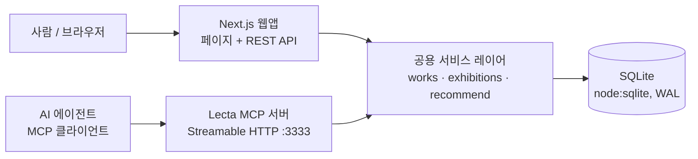

# Lecta — 1차 스프린트 리뷰 & UAT

> **A living exhibition of what you love — and why.**
> 좋아하는 영화·시리즈·책·앨범을 고르고, 왜 좋았는지 한 줄을 남기면 하나의 전시실이 된다. Lecta는 그 방을 읽고, 벽에 걸릴 다음 작품을 찾아 준다. 같은 기능을 AI 에이전트도 MCP로 쓸 수 있다.

| 항목 | 내용 |
| --- | --- |
| 팀 | THE GLEANERS (4인) |
| 일정 | 2026-10-31 1차 중간 발표 + UAT / 11-14 2차 UAT / 12-19 최종 발표 |
| 코드 | `github.com/yerielk/LT_THEGLEANERS` · 브랜치 `feat/uat-editorial-mcp` (main 미병합) |
| 기획안 | Notion 「기획안_10.26」 |

---

## 1. 한 장 요약

- **문제:** 영화·책·음악 기록이 플랫폼마다 흩어져 있고, 남는 건 별점과 시청 이력뿐이다. 무엇을 좋아했는지는 남아도 *왜* 좋아했는지는 사라진다. AI에게 추천을 받을 때도 내 취향을 매번 처음부터 설명해야 한다.
- **해결:** 매체를 가로질러 작품을 모아 **전시(방)** 로 큐레이션하고, 선택 이유를 함께 쌓는다. 그 맥락을 근거로 다른 매체의 작품을 추천하고, 같은 기능을 **MCP 서버**로 열어 외부 AI 에이전트도 쓸 수 있게 한다.
- **이번 스프린트 결과:** 기획 단계를 넘어 **실제로 동작하는 수직 단면**을 만들었다. 탐색 → 선택 → 전시 저장 → 추천 → 추천작 추가 → MCP 도구 호출과 재조회까지 한 흐름으로 이어진다.

## 2. 포지셔닝 — 왜 "전시"인가

| 기존 서비스 | 하는 일 | Lecta가 다른 점 |
| --- | --- | --- |
| Letterboxd · 왓챠피디아 | 한 매체 중심의 평점·리뷰·리스트 | 영화·책·음악을 **한 방에** 섞어 거는 전시 구조 |
| Cosmos · Are.na | 이미지와 링크를 모으는 시각적 수집 | 작품 단위의 정규화된 데이터 + **선택 이유** |
| Qloo 같은 Taste API | 교차 장르 취향 인텔리전스 | 사용자가 **직접 남긴 이유와 전시 맥락**을, 동의한 범위에서만 AI에 제공 |

방어 가능한 지점은 예쁜 화면이 아니라 네 가지의 결합이다.
① 사용자가 고른 작품 사이의 관계, ② 선택 이유라는 근거 데이터, ③ 매체를 넘나드는 전시 구조, ④ 에이전트가 권한 안에서만 쓰는 취향 맥락.

## 3. 스프린트 진행 공유

| 항목 | 상태 | 근거 |
| --- | --- | --- |
| 제품명·팀명·포지셔닝 | 완료 | Lecta / THE GLEANERS, 큐레이션·전시 우선 |
| 기획안·UAT 설계 | 완료 | Notion 기획안, UAT 시트 3개 시나리오 |
| 작품 데이터 | 완료(시드) | 실존 작품 46개(영화 12 · 시리즈 10 · 책 12 · 앨범 12), 태그 295개, 샘플 전시 4개 |
| Discover · 선택 트레이 | 완료 | 검색, 매체 필터, 무드 필터, 중복 선택 방지 |
| 전시 빌더 · 저장 · 재조회 | 완료 | 제목 필수 검사, 순서 변경, 한 줄 노트, 저장 후 새로고침해도 유지 |
| 콜드스타트 추천 + 근거 | 완료 | `coldstart-v1`, 점수 구성 공개, 근거 2개 이상 |
| MCP 서버 | 완료 | 도구 5개, 쓰기는 키와 사람 승인이 모두 있어야 실행 |
| 디자인 | 완료(1차) | 화이트 갤러리, 실제 포스터·표지·앨범 아트, 페이지 전환 애니메이션 |
| LLM 에이전트 자연어 실행 | 코드만 있음 | 모델 키가 없어 실행·검증하지 못함 |
| 로그인 · 공개 공유 | 미구현 | 데모 사용자 1명, 전시는 비공개 초안만 |

## 4. 데모 흐름 (UAT 3개)

1. **작품 탐색·선택:** 홈 → Explore the collection → `longing`으로 검색하고 영화·책·앨범을 하나씩 **+** 로 담는다. 하단 트레이에 3개가 쌓이고, 같은 작품은 두 번 담기지 않는다.
2. **전시 제작·저장:** Begin exhibition → 제목 `Longing & Other Quiet Things`, 소개, 작품별 한 줄 이유, 순서 변경 → Save draft → 새로고침해도 그대로 남아 있다. 제목이 비어 있으면 저장되지 않는다.
3. **추천과 AI 에이전트:** 전시실 하단 *A piece that belongs here*에서 근거가 붙은 추천을 받고 전시에 추가한다. 이어서 MCP 클라이언트로 `find_related_works({seed_work_ids:[2개], target_media:"book", limit:3})`를 호출하면 실제 카탈로그의 책 3권이 ID·제목·매체·근거와 함께 돌아온다.

> 현장 Pass/Fail은 실제로 본 것만 기록한다. LLM 에이전트 실행은 키가 없으면 Not Tested로 두고, 프로토콜 테스트와 구분해서 말한다.

---

## 5. 어떻게 설계하고 개발했나

### 5.1 진행 방식

1. **명세 먼저.** 노션 기획안을 바탕으로 Product Blueprint(데이터 모델, 추천 공식, MCP 도구 스펙, 화면 명세)와 구현 프롬프트를 작성했다. 성공 기준과 "하지 말 것"(가짜 데이터, 허위 성공 표시, 시뮬레이션 MCP)을 함께 적었다.
2. **AI 페어 개발.** 명세를 Claude(코딩 에이전트)에게 넘겨 구현하고, 팀은 방향·디자인·검수를 맡았다. 결과물은 반드시 테스트 로그로 확인한다는 원칙을 두었다.
3. **게이트 순서.** 환경 → 실데이터·Discover → 저장 가능한 전시 → 추천 → 실제 MCP → QA 순서로 진행했다. 화면 디테일 때문에 MCP나 추천을 미루지 않는다는 원칙을 지켰다.
4. **검증.** 단위 테스트, MCP 프로토콜 스모크 테스트, 브라우저 E2E(데스크톱·모바일)를 매번 다시 돌렸다. 새 컴퓨터에서 클론부터 설치·시드·빌드까지 되는지도 확인했다. 이 과정에서 `.gitignore`가 시드 데이터 폴더까지 무시하던 버그를 실제로 찾아 고쳤다.

### 5.2 아키텍처



- **하나의 엔진, 두 개의 입구.** 웹의 `/api/recommendations`와 MCP의 `find_related_works`·`recommend_for_exhibition`이 **같은 `recommend()` 함수**를 호출한다. 사람이 보는 추천과 에이전트가 받는 추천이 다를 수 없다.
- **MCP 서버는 별도 프로세스**이고 같은 DB를 읽고 쓴다. HTTP API를 감싼 흉내가 아니다.

| 영역 | 선택 |
| --- | --- |
| 웹 | Next.js 16 (App Router), React 19, TypeScript |
| 데이터 | Node 내장 `node:sqlite` + SQL 스키마 (Postgres로 옮기기 쉬운 형태) |
| 검증 | Zod 4 (REST와 MCP 입력 공통) |
| MCP | 공식 TypeScript SDK v2, Streamable HTTP |
| 테스트 | Vitest, MCP 공식 클라이언트 스모크, Playwright E2E |
| 전환 효과 | View Transitions API (`next-view-transitions`) |

### 5.3 데이터 모델

`users` · `works` · `work_tags` · `exhibitions` · `exhibition_items` · `taste_signals` · `recommendation_events` · `agent_activity`

- 영화·책·앨범을 테이블로 나누지 않고 **통합 Work** 하나로 다룬다. 같은 작품을 전시, 추천, 에이전트가 모두 참조한다.
- 태그에는 출처(`HUMAN_CURATED` / `EXTERNAL` / `LLM_SUGGESTED`)가 붙는다. 사용자가 쓴 이유 원문과, 거기서 추출한 태그는 **따로** 저장한다. AI 추정을 확정된 취향으로 저장하지 않는다.
- 추천 노출과 추가 이벤트를 기록해 둔다. 나중에 협업 필터링을 위한 학습 데이터가 된다.
- 유니크 인덱스로 같은 작품이 한 전시에 중복되지 않게 막고, `requestId`로 같은 저장이 두 번 생기지 않게 막는다.

### 5.4 추천 알고리즘 `coldstart-v1`

사용자 행동 데이터가 0이어도 동작하는 **Collection → Work** 추천이다.

```
score = 0.35·S + 0.25·W + 0.20·C + 0.10·D + 0.10·N
```

| 요소 | 의미 |
| --- | --- |
| S 맥락 유사도 | 후보와 전시 작품들의 태그 벡터 코사인 + 제목·설명 TF-IDF 코사인 |
| W 이유 일치 | 사용자가 고른 "좋아한 이유"(한·영 동의어 사전으로 태그화)와 후보 태그의 겹침 |
| C 주제 적합 | 전시 제목·소개·큐레이터 노트에서 뽑은 태그와 후보의 겹침 |
| D 다양성 | 이미 고른 추천과 너무 비슷하거나 같은 창작자면 감점 (MMR) |
| N 확장 | 전시에 없는 매체면 가점, 이미 있는 창작자면 감점 |

- 이유(W)나 주제(C) 입력이 없으면 그 가중치를 빼고 나머지로 다시 정규화한다.
- 이미 전시에 있는 작품, 같은 작품의 다른 매체판(예: 『파친코』 소설 ↔ 드라마), 메타데이터가 불완전한 작품은 제외한다.
- 근거는 모두 실제 태그 행이나 사용자 입력에서 나온다. 근거가 부족하면 `exploratory`로 표시하고 과장하지 않는다.
- 같은 입력에는 항상 같은 결과가 나온다. LLM이나 API 키 없이 동작한다.

### 5.5 MCP — 에이전트가 쓰는 Lecta

| 도구 | 종류 | 역할 |
| --- | --- | --- |
| `search_works` | 읽기 | 실제 작품 검색, ID 반환 |
| `find_related_works` | 읽기 | 시드 작품·전시 기반 교차 매체 추천 (UAT-03) |
| `get_exhibition` | 읽기 | 공개 전시, 또는 키가 있으면 본인 초안 |
| `recommend_for_exhibition` | 읽기 | 전시 기준 추천 (웹과 같은 엔진) |
| `create_exhibition_draft` | 쓰기 | 비공개 초안 생성. bearer 키 **+** `approvedByHuman` 필요, `requestId`로 중복 방지 |

- 실패는 `WORK_NOT_FOUND`, `UNAUTHORIZED`, `FORBIDDEN`, `VALIDATION_ERROR` 같은 명확한 코드로 돌려준다. 없는 작품을 만들어내지 않는다.
- 쓰기 뒤에는 `get_exhibition`으로 저장 상태를 다시 읽어 확인하는 흐름을 테스트로 고정했다.
- 모든 도구 호출을 `agent_activity`에 남긴다. 비밀값은 제외하고, `/agent-lab`에서 확인할 수 있다.

### 5.6 디자인

- **콘셉트:** 화이트 갤러리. 전시 하나가 방 하나이고, 방마다 색칠한 입구 벽이 있다. 작품은 같은 눈높이에 걸리고 미술관식 캡션이 붙는다. 칸 테두리나 카드 박스는 쓰지 않는다.
- **색:** 와다 산조 『배색 사전』(1933)의 공개 데이터에서 비비드하지만 차분한 6색을 골랐다. Deep Lyons Blue, Etruscan Red, Yellow Ocher, Green Blue, Old Rose, Oil Green.
- **글꼴:** Instrument Serif, Instrument Sans, Pretendard, Gowun Batang. 모두 OFL 무료 폰트다.
- **작품 이미지:** 위키백과 정보상자의 공식 포스터·표지·앨범 아트(46개 중 40개). 재배포하지 않고 링크로 표시하며 출처를 남겼다. 이미지가 없는 작품은 자체 타이포그래피 표지로 보여 준다.
- **전환:** 홈의 방 패널이 전시실 입구로 이어지고, 작품 이미지가 상세 페이지로 이어진다. Discover에서 필터를 바꾸면 작품들이 새 자리로 미끄러진다. 모션을 줄이는 설정을 켠 사용자에게는 끈다.
- **레퍼런스:** MUBI Notebook(큰 타이포·편집 리듬), Apartamento(여백·개인성), A24(작품 중심 카탈로그), Are.na(수집·재배열). 분위기만 참고했고 자산은 복제하지 않았다.

### 5.7 검증 결과 (개발 환경 기준, 2026-10-31)

| 검사 | 결과 |
| --- | --- |
| 단위 테스트 (서비스·추천) | 15 / 15 통과 |
| MCP 프로토콜 스모크 (목록·호출·권한·쓰기·재조회) | 29 / 29 통과 |
| 브라우저 E2E (UAT-01·02 + 추천 추가, 1440px·390px) | 24 / 24 통과 |
| 프로덕션 빌드 · 새 클론 설치 | 통과 |
| LLM 에이전트 자연어 실행 | 미실행 (모델 키 없음) |

### 5.8 내린 결정과 이유

| 결정 | 이유 |
| --- | --- |
| Prisma 대신 `node:sqlite` | 빌드 환경에서 Prisma 엔진 다운로드가 막혀 검증할 수 없었다. 의존성 없는 내장 SQLite로 바꾸고, 스키마는 Postgres로 옮기기 쉽게 썼다. |
| 외부 API(TMDB 등) 대신 시드 카탈로그 | 첫 UAT에서는 API 키·호출 제한·약관 리스크 없이 안정적으로 시연하는 것이 우선이었다. 메타데이터는 `CURATED`로 표시했다. |
| 추천에 LLM을 쓰지 않음 | 재현 가능해야 하고 근거를 검증할 수 있어야 하며 키 없이도 돌아야 했다. LLM은 다음 단계에서 이유 태그 *제안*에만 쓴다. |
| 쓰기 도구에 이중 잠금 | 에이전트가 사용자 몰래 저장하지 못하게 하려고, 키와 사람의 명시적 승인을 모두 요구했다. |

## 6. 한계와 다음 스프린트 (11/1–11/14)

- **계정과 공개:** 로그인, 공개 링크와 권한(공개 전시만 외부 접근).
- **데이터:** TMDB·Google Books·MusicBrainz로 메타데이터와 이미지를 검증해 `VERIFIED`로 올리고, 카탈로그를 60–100개로 늘린다.
- **추천:** 임베딩을 도입하고, 이유 문장에서 태그를 제안하는 LLM 단계를 넣는다(사용자 확인 후 저장). 오프라인 평가셋도 만든다.
- **에이전트:** 실제 LLM 에이전트를 실행해 검증하고, 원격 MCP 인증(OAuth)을 붙인다.
- **UAT 피드백 반영:** 이유 입력의 부담, 추천 근거를 이해할 수 있는지, 전시 흐름이 자연스러운지.

---

## 7. 예상 질문 대비

### 기획 · 비즈니스

**Q. Letterboxd나 왓챠피디아와 뭐가 다른가요?**
A. 그 서비스들은 한 매체 안에서 평점·리뷰·리스트를 관리합니다. Lecta의 단위는 영화·책·앨범이 함께 걸리는 **전시**이고, 각 작품에 "왜"가 붙습니다. 그 이유 데이터가 추천 근거가 되고, 사용자가 동의한 범위에서 AI 에이전트에게 전달됩니다.

**Q. 왜 기록 앱이 아니라 '전시'인가요?**
A. 기록은 관리의 대상이라 쌓일수록 부담이 됩니다. 전시는 표현의 대상이라 만들고 보여주는 동기가 생깁니다. 기획 단계에서 "큐레이션 우선, 기록은 기반"으로 결정했고, 장문 리뷰 대신 한 줄 이유만 받습니다.

**Q. 사용자가 굳이 '좋아한 이유'를 쓸까요? 기록 피로는?**
A. 필수가 아닙니다. 전시를 만들 때 작품마다 한 줄을 *선택적으로* 쓰고, 추천에서는 이유 키워드를 탭 한 번으로 고릅니다. 이유가 없어도 추천은 동작합니다. 실제 입력률은 이번 UAT에서 확인하려는 질문 중 하나입니다.

**Q. 기존 서비스에 쌓인 기록을 옮겨 올 이유가 있나요?**
A. 처음부터 전부 옮기라고 하지 않습니다. 작품 3–4개로 방 하나를 만드는 데서 시작합니다. 가져오기 기능은 약관을 검토한 뒤 후속으로 계획하고 있습니다.

**Q. 타깃은 누구고, 검증했나요?**
A. 문화 콘텐츠를 소비를 넘어 기록·배치·해석·공유하고 싶어 하는 20대 중심 사용자를 가설로 잡았습니다. 아직 검증 전이고, 이번 UAT가 첫 검증입니다.

**Q. 친구가 없어도 쓸 만한가요?**
A. 네. 혼자서도 방을 만들고 추천을 받을 수 있게 설계했습니다. 친구와의 취향 비교와 공동 전시는 후속 기능입니다.

**Q. 수익 모델은요?**
A. 단계별로 검토하고 있습니다. 초기에는 서점·음반·티켓 제휴(큐레이티드 커머스)를 시험합니다. 중기에는 독립 서점·영화제를 위한 B2B 큐레이션 도구와 투명하게 표시한 스폰서 전시를 봅니다. 장기적으로는 동의 기반 Taste MCP/API 사용량 과금을 생각합니다. 제휴 수익만으로는 작다는 계산(MAU 1만 기준 월 약 16만 원)이 있어 B2B와 API 쪽을 더 크게 보고 있습니다. 모두 아직 검증 전입니다.

**Q. 성공을 무엇으로 측정하나요?**
A. 북극성 지표는 **유효 컬렉션 완성률**입니다. 첫 탐색 후 7일 안에 서로 다른 매체 3개 이상과 큐레이터 노트 1개가 담긴 전시를 저장한 사용자 비율입니다. 보조 지표로 추천→추가 전환율, 추천 근거 이해도, MCP 호출 성공률을 봅니다.

### 추천

**Q. 추천은 AI가 하나요? 어떻게 동작하나요?**
A. LLM이 아니라 설명 가능한 점수 공식입니다. 전시 작품과의 맥락 유사도, 사용자가 고른 이유와의 일치, 전시 주제와의 적합도, 다양성, 다른 매체로의 확장을 0–1로 계산해 합칩니다. 같은 입력에는 같은 결과가 나오고, 점수 구성을 화면에 그대로 보여줍니다.

**Q. 사용자 데이터가 0인데 추천이 되나요?**
A. 됩니다. 사용자 행동이 아니라 **지금 만들고 있는 전시**를 입력으로 쓰는 Collection → Work 추천이라서, 작품 2개만 있어도 동작합니다.

**Q. 태그는 누가 붙였나요? 주관적이지 않나요?**
A. 주관적입니다. 그래서 출처를 `HUMAN_CURATED`(편집 해석)로 표시하고, 작품에 대한 사실이 아니라고 화면에 명시합니다. 이번 시드 태그는 개발 과정에서 AI의 도움을 받아 초안을 만든 것이라 팀이 검토해야 합니다. 다음 단계에서는 사용자 이유와 외부 메타데이터로 보강합니다.

**Q. 추천 이유가 지어낸 말(환각)이 아니라는 걸 어떻게 아나요?**
A. 이유 문장은 생성하지 않습니다. 실제 태그 행, 근거가 된 전시 작품 ID, 사용자가 입력한 문구로만 조립합니다. 테스트에서 모든 근거 태그가 후보 작품과 근거 작품 양쪽에 실제로 있는지 확인합니다.

**Q. 맨날 비슷한 것만 나오지 않나요?**
A. 다양성(MMR) 항목이 이미 고른 추천과 비슷한 후보와 같은 창작자를 감점하고, 전시에 없는 매체에는 가점을 줍니다. 이유나 매체 필터를 바꾸면 결과가 설명 가능한 방향으로 달라지는 것도 테스트로 확인합니다.

**Q. 나중엔 어떻게 좋아지나요?**
A. 0–100명 구간에서는 태그와 임베딩, 명시적 이유를 씁니다. 사용자가 늘면 추천 노출·추가 이벤트로 가중치를 조정하고, 충분해지면 "함께 전시된 작품" 공출현과 협업 필터링을 콘텐츠 점수와 섞습니다. 이를 위한 이벤트는 지금부터 기록하고 있습니다.

### MCP · AI 에이전트

**Q. MCP가 뭐고, 그냥 API와 뭐가 다른가요?**
A. MCP는 AI 에이전트가 도구를 발견하고, 입력 형식을 이해하고, 호출하는 표준 프로토콜입니다. 에이전트가 문서 없이도 `tools/list`로 Lecta가 무엇을 할 수 있는지 알고 바로 쓸 수 있습니다. OT에서 말한 "UI 없이도 에이전트가 쓸 수 있는 제품"을 이렇게 구현했습니다.

**Q. 에이전트 데모가 진짜 호출인가요, 시뮬레이션인가요?**
A. 진짜입니다. 별도 프로세스로 뜬 MCP 서버에 공식 MCP 클라이언트가 접속해 도구를 호출하고, 결과는 같은 DB에 남습니다. Agent lab 화면에서 실제 호출 기록과 시간을 볼 수 있습니다. 다만 **LLM이 자연어로 도구를 고르는 실행**은 모델 키가 없어 아직 검증하지 못했고, 발표에서도 그렇게 구분해서 말합니다.

**Q. 에이전트가 내 데이터를 마음대로 바꾸면요?**
A. 읽기와 쓰기를 분리했습니다. 쓰기 도구는 비공개 초안 생성 하나뿐이고 bearer 키와 사람의 승인 플래그가 모두 있어야 실행됩니다. 공개·삭제는 에이전트에게 열지 않았습니다. 같은 요청을 다시 보내도 중복으로 생기지 않고, 비공개 초안은 키 없이 읽을 수 없습니다.

**Q. Claude나 ChatGPT에 바로 연결되나요?**
A. 로컬에서는 MCP Inspector와 공식 클라이언트로 검증했습니다. 외부 호스트에 연결하려면 배포와 OAuth 인증이 필요해서 다음 스프린트 범위입니다. 검증하지 않은 연결은 된다고 말하지 않습니다.

### 기술 · 개발

**Q. AI로 개발했나요? 팀은 무엇을 했나요?**
A. 네. 팀이 기획안, 제품 명세, 데이터·추천·MCP 계약, 디자인 방향과 레퍼런스, UAT 시나리오를 만들었고, 구현은 AI 코딩 에이전트와 페어로 진행했습니다. 대신 "동작하지 않는 것을 완료라고 하지 않는다"는 원칙으로 모든 단계를 테스트로 검증했고, 커밋 기록과 테스트 로그가 레포에 남아 있습니다. 다음 스프린트부터는 역할별(FE/BE/AI·MCP/PM·디자인)로 코드를 나눠 직접 확장합니다.

**Q. 왜 SQLite인가요? 확장성은?**
A. 첫 UAT에서는 설치 없이 바로 돌고 영속성을 확인할 수 있는 게 중요했습니다. 스키마를 Postgres로 옮기기 쉬운 형태로 썼기 때문에 Supabase/Postgres 이전은 방언 변경 수준입니다.

**Q. 로그인이 없는데 '내 전시'는요?**
A. 현재는 `DEMO_MODE`에서 고정 데모 사용자 하나로 저장합니다. 화면에 Demo workspace라고 표시하고, 공개 배포에서는 쓰기를 막습니다. 계정은 다음 스프린트 범위입니다.

**Q. 테스트는 어떻게 했나요?**
A. 세 층으로 했습니다. 단위 테스트는 결정성, 시드 제외, 매체 필터, 근거 검증, 권한을 봅니다(15개). MCP 스모크는 도구 목록, 호출, 오류, 쓰기 권한, 재조회를 봅니다(29개). 브라우저 E2E는 실제 클릭으로 UAT-01·02와 추천 추가를 데스크톱과 모바일에서 확인합니다(24개).

**Q. 외부 콘텐츠 API(TMDB 등)는 왜 안 썼나요?**
A. 첫 UAT에서는 키, 호출 제한, 약관, 네트워크 의존 없이 안정적으로 시연하는 것을 우선했습니다. 작품 정보는 팀이 입력한 `CURATED` 상태로 표시했고, 다음 스프린트에 API로 검증해 `VERIFIED`로 올립니다.

### 디자인 · 저작권

**Q. 포스터·표지 이미지 써도 되나요?**
A. 작품 식별 목적으로 위키백과 정보상자 이미지에 **링크**만 걸었고, 파일을 재배포하지 않습니다. 작품 페이지에 출처와 "© 권리자" 표기를 했습니다. 정식 서비스에서는 TMDB 같은 제공자의 표시 조건(출처 표기 등)을 따르는 경로로 바꿀 계획입니다. 이미지가 없거나 깨지면 자체 타이포그래피 표지로 대체됩니다.

**Q. 디자인과 색은 어떻게 정했나요?**
A. 전시회에서 방마다 벽 색이 다른 경험을 웹으로 옮겼습니다. 색은 와다 산조의 『배색 사전』(1933) 공개 데이터에서 골랐고, 레퍼런스는 MUBI Notebook, Apartamento, A24, Are.na입니다. 폰트는 모두 OFL 무료 폰트입니다.

### UAT 진행

**Q. 시연 중에 실패하면요?**
A. Pass로 적지 않고 원인과 재현 절차를 기록합니다. 현장에 인터넷이 없으면 이미지와 폰트가 대체 표지·시스템 폰트로 바뀌지만 기능은 그대로 동작합니다.

**Q. 이번 UAT에서 꼭 듣고 싶은 피드백은?**
A. ① 전시 경험이 기존 기록 앱과 충분히 다르게 느껴지는지, ② 작품을 담고 전시를 완성하는 흐름이 자연스러운지, ③ 추천 이유가 이해되고 믿을 만한지, ④ AI가 MCP로 직접 쓰는 제품이라는 점이 명확하게 전달되는지.

---

## 부록 — 실행 방법

```bash
npm install && cp .env.example .env   # LECTA_MCP_WRITE_KEY 에 임의 값
npm run db:setup
npm run dev          # 웹 http://localhost:3000
npm run mcp:dev      # MCP http://127.0.0.1:3333/mcp
npm run mcp:smoke    # 시연 전 PASS 확인
```

자세한 시연 대본은 레포의 `UAT_DEMO.md`, 기술 상세는 `README.md`에 있다.
