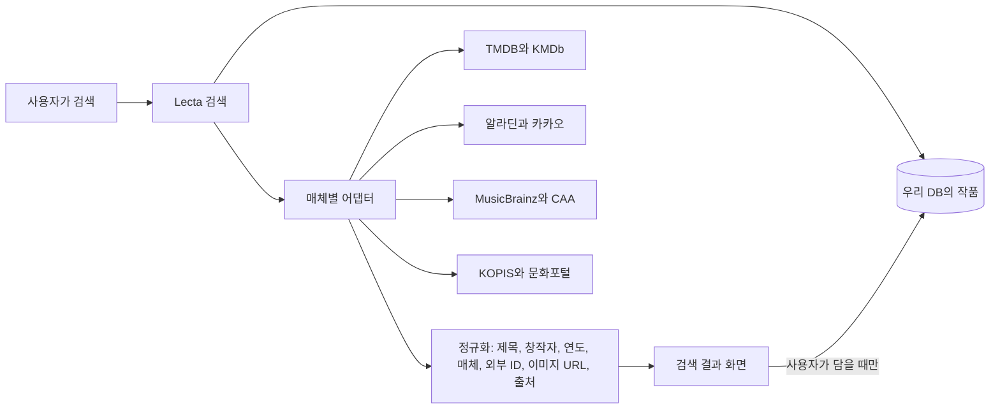

# UAT 피드백 리서치: 데이터 확보, 기술, 방향성

10월 31일 발표 질의응답에서 나온 피드백을 바탕으로 세 가지를 조사했습니다. 첫째는 작품 데이터와 이미지를 어디서 어떻게 확보할지, 둘째는 그 밖에 손봐야 할 기술적인 부분, 셋째는 서비스 방향을 정하는 데 참고할 레퍼런스 서비스입니다. API 조건은 2026년 10월에 공개 문서로 확인한 내용이라 실제 연동 전에 각 약관을 다시 확인해야 합니다.

---

## 0. 피드백 한눈에

| 주제 | 받은 피드백 | 이 문서의 답 |
| --- | --- | --- |
| 데이터 확보 | 매체가 넓은데 제목, 커버, 날짜 같은 데이터를 어떻게 미리 갖출 것인가 | 2장. 미리 다 모으지 않고, 매체별 공식 API를 검색할 때 불러와 사용자가 담는 순간 저장 |
| 이미지 저작권 | 이미지는 저작권 때문에 막혀 있는 경우가 많다 | 2장. 이미지 사용을 허락하는 API의 이미지 서버만 쓰고, 출처를 표시하고, 직접 올린 사진을 대안으로 |
| 서비스 정체성 | 아카이빙, 큐레이션 공유, 추천 중 무엇이 1순위인가 | 4장. 나를 드러내는 취향 아카이브를 1순위로, 큐레이션은 보여주는 형식으로, 추천은 그 결과로 |
| 콘텐츠 품질 | 공개 글의 품질이 낮으면 방문자가 떠난다 | 3장 3절과 4장. 비공개를 기본값으로 두고, 공개할 때만 품질 장치와 선정을 적용 |
| 표현과 전문성의 균형 | 자유도를 높일지 구조를 강하게 할지 중간 지점을 정해야 한다 | 4장. 제약 안의 자유(예: Letterboxd의 Four Favourites) |
| 진정성 | 보여주기용 취향이 아니라 진짜 취향을 남기게 해야 한다 | 4장. 비공개 우선, 실제 기록 가져오기, 시간 기록, 반응 수 숨기기 |
| TF-IDF | 제목이 비슷한 작품끼리 추천되는가 | 3장 2절. 제목이 아니라 줄거리와 태그와 창작자를 비교하며, 제목은 비교 대상에서 빼는 것으로 정리 |
| 개인 페이지 생성 | 취향과 무드를 분석해 나를 표현하는 웹페이지를 만들어 주는 방향 | 4장. Bento 종료로 생긴 빈자리와 맞물려 유력한 방향으로 제안 |

---

## 1. 결론부터

- **데이터는 미리 다 모으지 않습니다.** 매체별 공식 API를 검색할 때 불러오고, 사용자가 담는 순간에만 우리 DB에 정규화해 저장하는 방식이 현실적입니다. 데이터를 긁어오는 크롤링은 약관 위반과 저작권 문제 때문에 피합니다.
- **첫 확장 매체는 영화와 책입니다.** TMDB와 알라딘이 데이터와 표지 이미지를 가장 안정적으로 줍니다. 음악은 Spotify가 2025년부터 신규 앱을 사실상 막아서 MusicBrainz와 Cover Art Archive를 기본으로 씁니다.
- **정체성은 "나를 드러내는 취향 아카이브"로 좁히는 것을 제안합니다.** 비전문가의 큐레이션을 낯선 사람이 왜 보느냐는 질문은, 사람들이 작품이 아니라 그 사람을 보러 오는 구조로 바꾸면 풀립니다.
- **이미 비슷한 국내 앱 Tastify(취향의 방)가 있습니다.** 월별로 방을 열어 음악, 책, 영화를 기록하고 친구의 방에 놀러 가는 구조라서 차별점을 다시 정리해야 합니다. Lecta의 차별점은 매체를 넘는 추천, 작품마다 남기는 이유, AI 연결입니다.

---

## 2. 데이터 확보

### 2.1 매체별 데이터 소스

| 매체 | 소스 | 받을 수 있는 것 | 조건과 한계 | Lecta에서의 역할 |
| --- | --- | --- | --- | --- |
| 영화, 시리즈 | **TMDB API** | 제목, 줄거리, 장르, 출연진, 포스터와 스틸, 다국어 제목 | 비상업 용도는 무료지만 TMDB를 출처로 표시하고 "TMDB API를 사용하지만 TMDB의 보증은 받지 않았다"는 문구와 로고를 넣어야 합니다. 수익이 목적이 되면 별도 상업 라이선스가 필요합니다 | 영화와 시리즈의 기본 소스 |
| 영화(국내) | **KMDb(한국영상자료원)**, **KOBIS(영화진흥위원회)** | 한국 영화 상세 정보, 박스오피스와 개봉 정보 | 공공데이터포털에서 키를 발급받습니다 | 한국 영화 보강, 신작 개봉 정보(광고 수익 모델의 재료) |
| 책 | **알라딘 Open API(TTB 키)** | 상품 검색, ISBN 조회, 신간과 베스트셀러, 표지 이미지(최대 200px) | 한 페이지 최대 50개, 결과 최대 200개 | 국내 책의 기본 소스 |
| 책 | **카카오(다음) 책 검색 API**, **국립중앙도서관 ISBN 서지 API**, **Google Books**, **Open Library** | 검색, 서지 정보, 썸네일 | 카카오는 상업 이용과 캐싱 범위를 개발자 포럼에서 확인해야 합니다 | 알라딘 보조, 외서 |
| 음악 | **MusicBrainz + Cover Art Archive** | 앨범, 곡, 아티스트의 공개 메타데이터, 앨범 커버(250px, 500px, 1200px 썸네일) | MusicBrainz 데이터는 공개되어 있고 Cover Art Archive는 앨범 ID로 커버를 바로 가져옵니다. 이미지별 라이선스는 따로 명시되지 않아 출처 표시가 필요합니다 | 음악의 기본 소스 |
| 음악 | **iTunes Search API** | 앨범, 곡 검색, 아트워크 | 분당 약 20회. 아트워크는 구매 페이지를 홍보하는 용도로만, 구매 배지와 링크를 함께 써야 합니다 | 검색 보조. 아트워크를 쓰려면 Apple Music 링크를 함께 표시 |
| 음악 | **Spotify Web API** | 검색, 트랙 정보 | 2025년 4월 기준으로 확장 접근은 법인이면서 월 사용자 25만 명 이상인 서비스로 제한되고, 개발 모드는 테스트 사용자 25명까지입니다. 추천과 오디오 특성 API는 2024년에 막혔습니다 | 이번 학기에는 쓰지 않음. 개인 계정 연동 실험 정도 |
| 공연, 전시 | **KOPIS(공연예술통합전산망)**, **문화포털 "한눈에보는문화정보"(한국문화정보원)** | 공연과 전시 목록, 기간, 장소, 장르, 상세 | 공공데이터포털 키가 필요합니다. 이용 범위 제한이 없는 공공데이터도 있습니다 | 공연과 전시 매체 추가, 취향 맞춤 신작 알림 |
| 매체 연결 | **Wikidata** | 한 작품의 TMDB ID, ISBN, MusicBrainz ID를 서로 잇는 식별자 | 데이터는 CC0 | 원작 소설과 영화처럼 매체를 넘는 같은 작품 묶기 |

### 2.2 전략: 미리 다 모으지 않고, 담는 순간 저장한다

피드백에서 걱정한 지점은 "사용자가 등록할 때 편하려면 DB에 데이터가 미리 엄청 쌓여 있어야 하지 않느냐"였습니다. 이 걱정은 검색할 때 외부 API를 불러오는 구조로 풀 수 있습니다.

1. **검색 단계:** 우리 DB를 먼저 찾고, 부족하면 매체별 어댑터가 외부 API를 동시에 부릅니다. 결과는 짧게(예: 24시간) 캐시해서 호출 한도를 아낍니다.
2. **정규화:** 각 API의 응답을 Lecta의 `works` 형식으로 맞추고 `external_ids`(TMDB ID, ISBN, MBID, KOPIS ID 등)와 `source`, `fetched_at`을 함께 둡니다. 지금 스키마의 `metadata_status`를 `VERIFIED`로 올리는 근거가 됩니다.
3. **저장 시점:** 사용자가 + 를 눌러 담는 순간에만 DB에 영구 저장합니다. 그래서 DB는 사용자가 실제로 쓰는 작품 위주로 자라고, 외부 데이터를 통째로 복제하지 않습니다.
4. **같은 작품 묶기:** Wikidata 식별자로 원작 소설과 영화, 사운드트랙을 연결하면 매체를 넘는 추천과 같은 제목 제외 규칙이 정확해집니다.
5. **어디에도 없을 때:** 사용자가 직접 등록하거나, 에이전트가 웹에서 찾아 초안을 채우고 사용자가 확인하는 흐름을 둡니다. 출처는 `USER_SUBMITTED`나 `AGENT_SUGGESTED`로 따로 표시하고 검수 전에는 다른 사람에게 노출하지 않습니다. 피드백에서 나온 "입력하면 에이전트가 실시간으로 찾아온다"는 아이디어를 안전하게 넣는 방법입니다.

### 2.3 이미지와 저작권

- **원칙:** 이미지 사용을 허락하는 API의 이미지만, 그 API의 이미지 서버 주소로 표시하고 출처를 답니다. 파일을 우리 서버에 복제해 재배포하지 않습니다.
- **TMDB:** 비상업 용도에서 출처와 로고 표시를 지키면 포스터를 쓸 수 있습니다. 수익화 단계에서는 상업 라이선스가 필요합니다.
- **알라딘:** API가 표지 URL을 직접 주고, 상품 링크를 함께 걸어 두는 것이 안전합니다.
- **Cover Art Archive:** 커뮤니티가 올린 커버를 앨범 ID로 줍니다. 출처를 표시합니다.
- **Apple(iTunes):** 아트워크는 구매 페이지를 홍보하는 용도로만 쓸 수 있어서, 쓰려면 Apple Music 링크를 함께 둬야 합니다.
- **지금 쓰는 위키백과 이미지:** 식별 목적으로 링크만 거는 임시 방식입니다. 위키백과의 포스터와 앨범 커버 상당수는 공정 이용으로 올라온 비자유 파일이라, 정식 서비스 전에 위 API 이미지로 바꿔야 합니다.
- **대안:** Tastify처럼 사용자가 직접 찍은 사진(책 실물, 티켓, 전시장)을 커버로 쓰게 하면, 저작권 문제를 피하면서 개인적인 기록의 느낌도 강해집니다.

### 2.4 단계별 적용

| 시점 | 할 일 |
| --- | --- |
| 11/14 | 영화와 시리즈는 TMDB, 책은 알라딘으로 검색할 때 불러오고 담는 순간 저장. 출처와 로고 표시 화면. 기존 132개 작품에 외부 ID를 붙여 `VERIFIED`로 전환 |
| 12/19 | 음악은 MusicBrainz와 Cover Art Archive, 국내 영화는 KMDb와 KOBIS. Wikidata로 매체 간 연결. 사용자 직접 등록과 사진 커버 |
| 이후 | 공연과 전시는 KOPIS와 문화포털. 곡 단위 매체. 다른 서비스 기록 가져오기(Letterboxd와 Goodreads의 CSV 내보내기) |

---

## 3. 그 밖의 기술적인 부분

### 3.1 매체별 어댑터 구조

외부 API마다 응답 형식과 호출 한도가 다르기 때문에, `src/lib/providers/` 아래에 매체별 어댑터를 두고 모두 같은 인터페이스(`search(query)`, `lookup(externalId)`, `normalize(raw)`)를 따르게 합니다. 이렇게 하면 소스를 바꾸거나 더할 때 서비스 코드와 MCP 도구는 건드리지 않아도 됩니다. 호출 한도를 지키기 위해 어댑터마다 요청 큐와 지수 백오프를 두고, 키는 지금처럼 `.env`에만 둡니다.

데이터가 늘어나면 SQLite에서 Postgres(Supabase)로 옮기고, 검색은 Postgres 전문 검색이나 한국어 형태소 처리가 되는 검색 엔진으로, 추천용 벡터는 pgvector로 옮기는 순서가 자연스럽습니다.

### 3.2 추천: TF-IDF 질문에 대한 정리

질문은 "TF-IDF면 제목이 비슷한 작품끼리 추천되느냐"였습니다. 지금 TF-IDF가 비교하는 텍스트에는 줄거리와 태그와 창작자가 들어가고 제목도 일부 섞여 있습니다. 앞으로는 다음처럼 정리하는 것을 제안합니다.

- **제목은 비교 대상에서 뺍니다.** 같은 제목의 다른 매체판은 이미 규칙으로 제외하고 있으니, 제목 단어가 점수에 들어갈 이유가 없습니다.
- **태그를 자동으로 붙입니다.** 외부 API로 들어오는 작품은 팀이 손으로 태그를 달 수 없으니, LLM이 줄거리와 장르를 읽고 Lecta의 태그 사전 안에서 태그를 제안하게 하고, 출처는 `LLM_SUGGESTED`로 둡니다. 사용자가 확인하거나 이유로 쓴 태그만 가중치를 높입니다.
- **임베딩을 더합니다.** 다국어 문장 임베딩으로 줄거리와 사용자의 이유 문장을 같은 공간에 놓으면, 한국어로 쓴 이유와 영어 줄거리도 비교할 수 있습니다.
- **가중치 조정:** 발표에서 말한 대로 처음에는 "이 추천 어때요?" 버튼으로 만족도를 받아 비율을 조정하고, 노출, 추가, 만족도 데이터가 쌓이면 학습 기반 랭킹으로 넘어갑니다. `recommendation_events` 테이블에 반응 종류만 더하면 됩니다.

### 3.3 공개 콘텐츠 품질 장치

| 장치 | 방식 | 근거 |
| --- | --- | --- |
| 비공개가 기본 | 모든 방은 나만 보기로 시작하고, 공개는 사용자가 고를 때만 | 쓰는 부담과 품질 걱정을 동시에 낮춤 |
| 쓰기 도우미 | 장면, 감정, 누구에게 권하고 싶은지 같은 짧은 질문으로 한 줄을 끌어냄 | 빈 칸보다 질문에 답하는 것이 쉽고 글의 결이 고름 |
| 다듬기 버튼 | 맞춤법과 문장을 LLM이 다듬은 안을 보여 주고, 사용자가 고른 것만 반영 | 품질을 올리되 사용자의 목소리를 지움 |
| 공개 전 최소 기준 | 피드에 오르려면 작품 3개 이상과 이유 2개 이상 같은 기준 | 빈 전시가 피드를 채우지 않게 |
| 큐레이터 선정 | 브런치의 작가 신청처럼, 공개 피드의 "큐레이터" 배지는 신청과 선정으로 | 모든 사용자에게 심사를 요구하지 않으면서 상단 품질을 지킴 |

### 3.4 MCP 쪽에서 할 수 있는 것

외부 데이터 소스 자체를 MCP 도구로 두는 방향도 있습니다. 실제로 알라딘 도서 검색 MCP 서버처럼 공개된 예가 이미 있습니다. Lecta MCP에 `search_external_works`(외부 API를 불러 정규화한 결과를 돌려주는 읽기 도구)를 더하면, 사용자가 쓰는 AI가 대화 중에 찾은 작품을 Lecta 형식으로 바로 담을 수 있습니다.

---

## 4. 방향성을 위한 레퍼런스

### 4.1 레퍼런스 서비스

| 서비스 | 무엇을 하는가 | Lecta가 배울 점 | 관련 피드백 |
| --- | --- | --- | --- |
| **Tastify: 취향의 방** | 음악, 책, 영화, 장소, 옷 같은 좋아하는 것을 월별 방에 기록하고 친구의 방에 놀러 가는 국내 앱. 갤러리 사진으로 표지를 꾸밀 수 있음 | 가장 가까운 국내 경쟁 서비스. "방"과 친구 방문이라는 같은 은유를 이미 씀. Lecta는 매체를 넘는 추천, 작품별 이유, AI 연결로 차별화해야 함 | 정체성, 데이터(사진 커버) |
| **Letterboxd Four Favourites** | 프로필에 인생 영화 4편을 거는 기능. 너무 쉽지도 어렵지도 않은 제약이라 고르는 행위 자체가 자기 표현이 되었고, 다른 분야에서도 따라 하는 형식이 됨 | 자유도와 구조의 중간 지점 예시. "이 방의 대표작 4개" 같은 제약을 두면 고르는 과정이 진지해지고 결과물의 품질도 고름 | 표현과 전문성의 균형, 진정성 |
| **브런치스토리** | 작가 신청을 거쳐 글을 발행하고, 글을 목차로 묶어 브런치북으로 엮음. 라이킷과 구독, 출판 제안으로 좋은 글이 드러남 | 공개 품질은 선정 장치로, 묶음은 "북"이라는 형식으로. Lecta의 전시가 브런치북에 해당 | 콘텐츠 품질 |
| **Pinterest 보드** | 남이 만든 이미지를 내 보드에 모아 취향을 시각화 | 만드는 것이 아니라 고르는 것만으로도 표현이 된다는 점. 전시 만들기의 진입 장벽을 낮추는 근거 | 정체성 |
| **멜론, Spotify 플레이리스트 공유** | 이미 있는 곡을 내 순서로 엮어 이름을 붙이고 공유 | 플레이리스트는 전문가가 아니어도 공유되고 소비됨. 사람들이 플레이리스트를 듣는 이유는 그 사람과 상황 때문 | 비전문가 큐레이션의 가치 |
| **Spotify Wrapped** | 1년 동안 실제로 들은 기록으로 나를 요약하는 카드를 만들어 공유하게 함 | 선언한 취향이 아니라 실제 행동으로 만든 요약이라 진정성이 있고, 공유가 자연스러움 | 진정성, 개인 페이지 생성 |
| **Bento(2026년 2월 종료)와 Linktree** | 나를 소개하는 한 장짜리 페이지를 예쁘게 만들어 주던 서비스. Linktree에 인수된 뒤 2026년 2월 13일 종료 | 피드백 8번의 "나를 드러내는 웹페이지 자동 생성"과 맞닿음. 링크 모음이 아니라 취향으로 만든 개인 페이지라는 빈자리가 생김 | 개인 페이지 생성 |
| **Are.na** | 블록을 채널에 모으고 연결하는 광고 없는 큐레이션 | 조용하고 정직한 큐레이션 문화. 좋아요 수를 앞세우지 않는 설계 | 진정성 |
| **StoryGraph, Goodreads** | 독서 기록, 분위기와 속도로 고르기, 기록 내보내기 | 다른 서비스의 기록을 가져오면 첫 방을 바로 만들 수 있음 | 데이터 확보, 진정성 |

### 4.2 정체성에 대한 제안

피드백의 핵심 결론은 "가장 큰 과제는 서비스의 정체성을 명확히 하는 것"이었습니다. 레퍼런스를 놓고 보면 세 갈래가 있습니다.

| 방향 | 사람들이 오는 이유 | 강점 | 약점 |
| --- | --- | --- | --- |
| 전문 큐레이션 플랫폼 | 좋은 큐레이션을 보러 | 콘텐츠 품질이 곧 경쟁력 | 비전문가가 만들면 볼 이유가 약함. 심사가 진입 장벽 |
| 개인 아카이브 | 내 기록을 남기러 | 진정성, 쓰는 사람이 곧 사용자 | 혼자 쓰면 Tastify, 노션과 구분이 어려움 |
| **나를 드러내는 취향 페이지(제안)** | 그 사람을 보러, 그리고 내 페이지를 만들러 | 비전문가의 큐레이션도 "그 사람의 것"이라 가치가 있음. 공유 동기가 강함. AI 연결과 추천이 자연스럽게 붙음 | 개인 페이지 디자인 자유도와 구조의 균형이 필요 |

그래서 다음과 같이 정리하는 것을 제안합니다.

> **Lecta는 좋아하는 작품과 그 이유로 나를 보여주는 취향 페이지를 만드는 서비스입니다.**
> 아카이브는 재료이고, 전시(큐레이션)는 보여주는 형식이며, 추천과 AI 연결은 쌓인 취향이 주는 보상입니다.

이렇게 정하면 남은 피드백도 같은 방향으로 풀립니다.

- **우선순위:** 아카이브와 전시를 먼저, 추천은 그다음입니다. 발표에서 답한 순서와 같습니다.
- **품질:** 비공개를 기본으로 하고, 공개 페이지는 Four Favourites처럼 제약이 있는 형식(대표작 4개, 방마다 이유 한 줄)으로 만들어 누가 만들어도 일정한 품질이 나오게 합니다.
- **진정성:** 공개 반응 수를 크게 보여주지 않고, 다른 서비스의 실제 기록을 가져오게 하고, 기록 날짜를 남겨 시간에 따라 취향이 변하는 모습을 보여줍니다. 같은 작품을 다시 봤을 때 감상이 달라지는 것도 기록할 수 있게 합니다.
- **개인 페이지 생성:** 이미 만든 와다 산조 팔레트와 방 구조를 그대로 써서, 사용자의 태그와 이유를 읽고 색과 배치를 골라 주는 "내 취향 페이지 만들기"를 12/19 목표의 취향 블로그와 합칩니다.

---

## 5. 다음 스프린트에 반영할 것

1. 발표 자료의 한 줄 목표를 4.2의 문장으로 바꾸고, 취향 블로그 슬라이드를 "나를 드러내는 취향 페이지"로 키웁니다.
2. 11/14까지 TMDB와 알라딘 어댑터를 붙여 검색할 때 불러오고 담는 순간 저장하는 흐름을 구현하고, 기존 작품에 외부 ID를 붙입니다.
3. 위키백과 이미지를 TMDB와 알라딘 이미지로 바꾸고, 출처 표시 화면을 만듭니다.
4. TF-IDF 비교 대상에서 제목을 빼고, LLM 태그 제안을 `LLM_SUGGESTED`로 저장하는 단계를 넣습니다.
5. 공개 범위 기본값을 비공개로, 공개 전 최소 기준과 쓰기 도우미 질문을 설계합니다.
6. Tastify와의 차이를 비교표에 추가합니다.

---

## 출처

- [TMDB API FAQ](https://developer.themoviedb.org/docs/faq)
- [Spotify: Updating the Criteria for Web API Extended Access (2025-04-15)](https://developer.spotify.com/blog/2025-04-15-updating-the-criteria-for-web-api-extended-access)
- [The State of Spotify Web API Report 2025 (DEV Community)](https://dev.to/leemartin/the-state-of-spotify-web-api-report-2025-4gh3)
- [알라딘 Open API 정리 (velog)](https://velog.io/@obb8923/알라딘-API-정리)
- [알라딘 OpenAPI 안내](https://www.aladin.co.kr/ttb/apiguide.aspx)
- [Cover Art Archive API (MusicBrainz Wiki)](https://wiki.musicbrainz.org/Cover_Art_Archive/API)
- [iTunes Store Web Service Search API](https://performance-partners.apple.com/resources/documentation/itunes-store-web-service-search-api/)
- [공공데이터포털: 공연예술통합전산망 API](https://data.go.kr/data/15097816/openapi.do)
- [문화포털 API 이용 안내](https://www.culture.go.kr/industry/apiGuideA.do)
- [Korean Movie Database (KMDb)](https://Www.Wikipedia.org/wiki/KMDb)
- [Wikidata: Identifiers](https://www.wikidata.org/wiki/Wikidata:Identifiers)
- [카카오 브런치 서비스 소개](https://www.kakaocorp.com/service/Brunch)
- [How Letterboxd's 'Four Favourites' took over the internet (The Spinoff)](https://thespinoff.co.nz/culture/24-04-2025/how-letterboxds-four-favourites-took-over-the-internet)
- [Tastify: 취향의 방 (App Store)](https://apps.apple.com/py/app/tastify-%EC%B7%A8%ED%96%A5%EC%9D%98-%EB%B0%A9/id1642958363)
- [Bento to shut down in 2026 (AlternativeTo)](https://alternativeto.net/news/2025/12/bento-to-shut-down-in-2026-as-linktree-takes-over-and-offers-migration-path/)
- [알라딘 도서 검색 MCP 서버 (Glama)](https://glama.ai/mcp/servers/@TeeDDub/mcp-aladin-books-server/blob/0d1ddb0576c5519e416d62aa782b689bcb47c59b/README.md)
