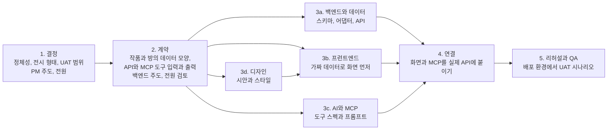

# THE GLEANERS 회의 자료와 회의록 (2026년 11월 9일 월)

- **참석:** 김예은, 배한준, 서지안, 홍순형
- **목적:** 서비스 방향과 데모데이(12/19)까지의 목표를 정하고, 이번 주 금요일(11/13) UAT까지 할 일과 역할을 나눈다.
- **사전 자료:** 이 문서의 부록(블로그와의 경쟁력, 전시의 형태),  `docs/Lecta_UAT_현장피드백_정리.md`(10/31 현장 피드백), `docs/Lecta_피드백_리서치.md`(데이터 확보와 레퍼런스 조사)

---

## 1. 지금까지 레포에서 바뀐 것

10/31 UAT 이후 main 브랜치에 PR 4건이 합쳐졌습니다(모두 11/8, 배한준).

| PR | 내용 | 의미 |
| --- | --- | --- |
| #2 Feat/auth postgres | SQLite에서 **PostgreSQL + Drizzle**로 이전(로컬은 docker compose, 테스트는 PGlite). **카카오 로그인**(Better Auth, 닉네임과 프로필 사진만). MCP 쓰기를 공용 키 대신 **사용자별 개인 키**로(내 방 화면에서 발급, 해시만 저장). **서버 한 대 배포 구성**(Docker, Caddy HTTPS, `docs/deploy.md`): 운영 환경에서는 데모 모드 금지, Agent lab은 관리자만, IP별 요청 제한. agent:demo를 Anthropic과 OpenAI 둘 다 지원 | 데모 단계에서 실제 서비스 단계로 넘어감. 계정과 데이터가 사용자별로 분리됨 |
| #1 UAT 10/31 phase 1 | 현장 피드백 1차 반영(아래 2장 표) | 화면 피드백 중 상당수 해결 |
| #3 catalog-132 | 작품 132개와 공식 이미지 99개를 main에 반영 | UAT 3번 결과가 The Sense of an Ending, The Great Gatsby, Stoner로 바뀜 |
| #4 ci/auto-deploy | main에 올리면 GitHub Actions가 테스트하고 EC2에 자동 배포 | **11/8 첫 실행이 실패 상태**라 확인 필요 |

그 밖에 확인할 것:
- 발표 대본, 시연 가이드 최신본, 피드백 정리, 리서치 문서는 아직 `feat/uat-editorial-mcp` 브랜치에만 있습니다. 문서만 main으로 옮기는 PR이 필요합니다.
- 메뉴 이름이 바뀌었습니다: Discover는 **Browse works**, My exhibitions는 **My rooms**, Curate는 메뉴 안으로 들어갔습니다.

---

## 2. 10/31 피드백 반영 현황

### 반영 완료 (main, PR #1)

| 피드백 | 반영 내용 |
| --- | --- |
| 가로 영역 위에서 휠이 막힘 | 세로 휠은 항상 페이지 스크롤. 옆으로 쓸기나 Shift와 휠일 때만 전시 벽 이동 |
| 가로 스크롤 힌트 | 이전과 다음 버튼, 처음 볼 때 힌트, 가장자리 페이드 |
| 검색 한 글자마다 새로고침 | 입력이 멈출 때까지 기다리고 한글 조합 중에는 더 기다림. 전환 애니메이션은 필터 클릭 때만 |
| 헤더 검정 버튼, 메뉴 이름 | 검정 버튼은 Sign in과 Sign up(카카오). Curate는 메뉴 안으로. 메뉴 이름 변경 |
| 로고 두껍게 | 로고 서체를 DM Serif Display로 |
| 방마다 색이 비슷함 | 와다 산조 12색, 이웃한 방끼리 색이 겹치지 않게(테스트 포함). 방 안에도 벽 색이 은은하게 |
| 코멘트는 작품 밑에 | 모든 작품 밑에 큐레이터 노트 |
| 상태 문구 줄바꿈 | 어색한 줄바꿈 제거 |
| 첫 화면에 작품이 안 보임 | 홈 제목과 소개를 옆으로 나란히 둬서 첫 화면에 작품이 보이게 |
| 추천 점수 막대 | 항목별 세로 막대 |
| 빌더 표지가 움직일 것 같음 | 고정된 것처럼 보이게 |
| 로그인과 회원가입 | 카카오 로그인 |

### 아직 남은 것

| 화면 | 남은 피드백 | 크기 | 금요일 가능? |
| --- | --- | --- | --- |
| 공통 | 명조와 고딕 서체 통일 점검 | 작음 | 가능 |
| 공통 | 태그의 한국어와 영어 혼용 정리 | 작음 | 가능 |
| 공통 | 탭 이름 한영 전환 | 중간 | 선택 |
| Browse works | 커버를 누르면 담기, 상세는 별도 버튼 | 작음 | 가능 |
| Browse works | 검색창과 분위기 필터 시각적 구분, 태그를 카테고리별로 묶고 정렬 | 작음 | 가능 |
| Browse works | 매체 표시와 제목을 한 덩어리로 | 작음 | 가능 |
| Browse works | 시리즈 포스터 비율 맞추기(로고나 가로 이미지 문제) | 중간 | 외부 API 이미지와 함께 |
| Browse works | 매체별 태그, 국내와 해외 필터 | 중간 | 데이터 결정 후 |
| Browse works | **없는 작품: 외부 검색으로 담기, 직접 추가, 신청과 알림** | 큼 | 외부 검색은 가능, 알림은 이후 |
| Browse works | 곡 단위 추가, 앨범 안에서 곡 고르기 | 큼 | 이후 |
| 전시 만들기 | 드래그로 순서 변경 | 중간 | 가능 |
| 전시 만들기 | 긴 글 입력 폼, 맞춤법 검사 | 중간 | 긴 글 폼은 가능, 맞춤법은 이후 |
| 전시실 | 새 페이지 대신 모달, 여백 누르면 닫기 | 중간 | 선택 |
| 전시실 | 배치 자유도와 템플릿 | 큼 | 이후(방향 결정 필요) |
| 신규 | 가입 시 관심 태그 고르기 | 중간 | 선택 |
| 기획 | 정체성, 블로그 대비 차별점, 공유 카드와 템플릿 | 결정 사항 | 오늘 결정 |

---

## 3. 금요일(11/13) UAT까지의 목표 제안

남은 시간은 화요일부터 목요일까지 사흘입니다. 오늘 정체성을 정하고, 그 방향을 가장 잘 보여줄 기능 세 가지를 UAT 항목으로 잡는 것을 제안합니다.

### 꼭 할 것
1. **CI 실패 원인 확인과 배포 주소 확정.** UAT를 배포된 주소에서 할지, 노트북에서 할지 정합니다.
2. **외부 검색으로 담기(TMDB, 알라딘).** "데이터를 어떻게 확보하나"라는 가장 큰 질문에 답이 됩니다. 검색할 때 불러오고 담는 순간 저장합니다.
3. **Browse works 사용성:** 커버를 누르면 담기, 검색과 필터 구분, 태그 묶기, 매체와 제목 묶기.
4. **전시 만들기:** 드래그 순서 변경, 긴 글 입력 폼.
5. **문서 정리:** 피드백 정리와 리서치 문서를 main에 반영하고 UAT 시트 작성.

### 할 수 있으면
- 공유 카드(전시를 SNS용 이미지 한 장으로 내보내기). 정체성을 "나를 드러내는 취향 페이지"로 정하면 가장 효과가 큽니다.
- 가입 시 관심 태그, 전시실 모달, 탭 이름 한영 전환.

### 이후로 미룰 것
- 곡 단위, 작품 신청과 알림, 맞춤법 검사, 레이아웃 템플릿, 매체별 태그와 국내외 필터.

### UAT 항목 후보 (시트에는 1~3개)

| 후보 | 시나리오 | 상태 |
| --- | --- | --- |
| A | 카카오로 로그인해 방을 만들고, 로그아웃 뒤 다시 들어와도 내 방이 남아 있다 | 구현됨, 배포 환경 확인 필요 |
| B | 카탈로그에 없는 영화나 책을 외부 검색으로 찾아 내 방에 담는다 | 이번 주 구현 |
| C | 내 방에서 발급한 개인 MCP 키로 에이전트가 내 방 초안을 만들고, 사람이 승인한 뒤 웹에서 바로 보인다 | 구현됨 |
| D | 내 방을 SNS 공유용 카드 한 장으로 내보낸다 | 시간이 되면 |

---

## 4. 오늘 논의할 안건

### 안건 1. 서비스의 정체성 (가장 먼저)

- **배경:** 현장 피드백의 핵심은 "메인 포인트가 나를 표현하는 것인지, 큐레이션을 공유하는 것인지"와 "지금 형태로는 블로그와 비교해 경쟁력이 없다"였습니다.
- **선택지:**
  - A. **나를 드러내는 취향 페이지.** 사람들은 작품이 아니라 그 사람을 보러 옴. 아카이브는 재료, 전시는 보여주는 형식, 추천과 AI는 보상(리서치 문서 4장 제안)
  - B. **큐레이션 공유 플랫폼.** 좋은 큐레이션을 보러 옴. 품질 관리와 선정이 핵심
  - C. **개인 취향 아카이브.** 기록이 목적. 진정성은 높지만 Tastify나 노션과 구분이 어려움
- **같이 정할 것:** 한 줄 정의 문장, 블로그나 Tastify와 다른 점 한 줄
- **결정:**
- **이유:**

### 안건 2. 데모데이(12/19)까지의 목표

- **배경:** 기존 계획은 취향 궁합, 공동 전시, 취향 블로그, 추천 피드백이었습니다. 안건 1의 결과에 따라 우선순위가 달라집니다.
- **A로 정한 경우의 예시:** 내 취향 페이지(템플릿 2~3종), 공유 카드, 외부 검색과 담기, 친구 페이지 방문과 취향 겹침 보기, 추천 만족도 버튼
- **정할 것:** 데모데이에 꼭 보여줄 장면 3개, 빼는 기능
- **결정:**

### 안건 3. 금요일 UAT 범위

- **정할 것:** UAT 시트 항목 1~3개(3장 후보 A~D 중), 시연 환경(배포 주소 또는 로컬), 시연자
- **결정:**

### 안건 4. 데이터 확보 전략

- **배경:** "방대한 데이터를 어떻게 모으나", "이미지 저작권"이 반복된 질문이었습니다.
- **제안:** 미리 다 모으지 않고, 검색할 때 공식 API에서 불러와 담는 순간 저장. 1순위는 영화와 시리즈(TMDB), 책(알라딘). 음악은 MusicBrainz와 Cover Art Archive(Spotify는 신규 앱이 사실상 막힘). 공연과 전시는 KOPIS와 문화포털
- **정할 것:** 이번 주에 붙일 소스, 곡 단위를 언제 할지, 위키백과 이미지를 언제 교체할지, 없는 작품의 처리 방식(직접 등록, 에이전트 초안, 신청과 알림)
- **결정:**

### 안건 5. 블로그와 다른 점, 공유 방식, 전시 형태 (부록 참고)

- **배경:** 네이버 블로그에는 글감 선택, 서로이웃, 게시판이 이미 있습니다.
- **선택지:** 공유 카드(카드뉴스 한 장), 취향 섹터별 페이지 템플릿, 매체를 넘는 추천과 이유 기반 연결, AI 연결
- **정할 것:** 블로그와의 관계(경쟁 또는 내보내는 원본), 전시 형태(벽 하나, 템플릿형, 자유 캔버스), 데모데이의 차별점 장면 하나
- **결정:**

### 안건 6. 공개 콘텐츠 품질과 진정성

- **제안:** 비공개를 기본값으로. 공개는 작품 3개 이상과 이유 2개 이상 같은 최소 기준. 대표작 4개처럼 제약 있는 형식. 반응 수는 크게 드러내지 않음
- **정할 것:** 기본 공개 범위, 공개 기준, 심사나 큐레이터 배지를 둘지
- **결정:**

### 안건 7. 개발과 배포 운영

- **확인할 것:** CI 실패 원인, 도메인과 카카오 Redirect URI 설정, 운영 환경 관리자 계정(`LECTA_ADMIN_USER_IDS`), 시연용 계정
- **협업 규칙 제안:** main은 PR로만 합치고 한 명 이상 리뷰. 기능마다 `feat/이름` 브랜치. 목요일 밤 코드 동결 후 배포 확인
- **결정:**

### 안건 8. MCP를 더 잘 쓰는 방법

- **배경:** 지금은 AI가 서비스를 쓸 수 있다는 증명 단계이고, 사용자 입장의 효용은 아직 약합니다(5.3절).
- **정할 것:** 이번 주 UAT에 붙일 MCP 장면 하나("대화하다 담기" 또는 "없는 작품 찾아오기"), 데모데이에 보여줄 MCP 장면
- **결정:**

### 안건 9. 역할분담과 협업 순서 (5장 제안 참고)

- **결정:**

---

## 5. 역할분담과 협업 순서

### 5.1 수정 사항별 분담 (이번 주, ~11/13)

역할을 크게 나누지 않고 이번 주에 할 수정 사항 단위로 나눴습니다. 크기는 작음(반나절 안팎)과 중간(하루 안팎)으로 표시했고, 네 명의 양이 비슷하도록 맞췄습니다. 서지안 님과 홍순형 님의 묶음은 서로 바꿔도 됩니다.

| 번호 | 수정 사항 | 크기 | 먼저 필요한 것 | 담당 |
| --- | --- | --- | --- | --- |
| 1 | 자동 배포(CI) 실패 원인 확인, 시연할 배포 주소 확정 | 작음 | 없음 | 배한준 |
| 2 | 데이터 계약: 외부 작품 형식(`ExternalWork`) 타입과 스키마, `works`에 외부 ID와 출처 칸 추가 | 중간 | 오늘 결정 | 배한준 |
| 3 | 담기 API: 외부 검색 결과를 담는 순간 DB에 저장, 중복 처리 | 중간 | 2 | 배한준 |
| 4 | TMDB 연동(영화, 시리즈 검색과 포스터) | 중간 | 2 | 홍순형 |
| 5 | 알라딘 연동(책 검색과 표지) | 중간 | 2 | 홍순형 |
| 6 | MCP 도구 `search_external_works`(에이전트가 없는 작품을 찾아오는 장면) | 작음 | 4, 5 | 홍순형 |
| 7 | Browse works에 "카탈로그 밖에서 찾기" 결과 화면 | 중간 | 2(가짜 데이터로 먼저) | 서지안 |
| 8 | 작품 카드: 커버를 누르면 담기, 상세는 별도 버튼 | 작음 | 없음 | 서지안 |
| 9 | 전시 만들기: 드래그로 순서 변경 | 중간 | 없음 | 서지안 |
| 10 | 검색창과 분위기 필터 구분, 태그를 카테고리별로 묶고 정렬, 매체와 제목 묶기 | 작음 | 없음 | 김예은 |
| 11 | 서체 통일, 태그 한국어와 영어 정리 | 작음 | 없음 | 김예은 |
| 12 | 전시 만들기: 긴 글 입력 폼 | 작음 | 없음 | 김예은 |
| 13 | 시안: 외부 검색 결과 화면, (가능하면) 공유 카드 | 작음 | 오늘 결정 | 김예은 |
| 14 | 문서 main 반영, UAT 시트 작성 | 작음 | 3장 결정 | 김예은 |
| 15 | 리허설: 배포 환경에서 UAT 시나리오 통과 | 작음 | 전부 | 전원(목 저녁) |
| 선택 | 공유 카드(방 하나를 SNS용 이미지로) | 중간 | 13 | 먼저 끝난 사람 |

- **배한준:** 1, 2, 3. 서버와 데이터 구조를 먼저 열어 주는 일이라 화요일 오전에 2번을 합쳐야 나머지가 시작됩니다. 그 밖에 PR 리뷰와 합치기를 맡습니다.
- **홍순형:** 4, 5, 6. 외부 데이터 연동과 그걸 쓰는 MCP 도구까지 한 흐름입니다.
- **서지안:** 7, 8, 9. 작품을 찾고 담고 배치하는 화면 쪽입니다.
- **김예은:** 10~14. 디자인과 PM, 그리고 화면을 다듬는 가벼운 프런트 작업입니다.

데모데이까지의 분담은 오늘 안건 1, 2(정체성과 목표)가 정해진 뒤 같은 방식으로 다시 나눕니다.

### 5.2 협업 순서: 계약을 먼저 정하고 나란히 만든다

네 명이 서로를 기다리지 않으려면, 화면과 서버와 AI가 주고받을 데이터의 모양(계약)을 첫날 정하고 그다음은 각자 나란히 작업하는 순서가 좋습니다.

| 단계 | 언제 | 무엇을 | 산출물 |
| --- | --- | --- | --- |
| 1. 결정 | 월(오늘) | 정체성, 전시 형태, UAT 항목, 역할 | 이 회의록의 결정 사항 |
| 2. 계약 | 화 오전 | 외부 작품의 정규화 형식(`ExternalWork`), 담기 API, MCP 도구의 입력과 출력, 화면에 필요한 필드 | `src/lib/types`와 Zod 스키마 PR 하나. 이것만 먼저 main에 합침 |
| 3. 나란히 만들기 | 화 오후 ~ 수 | 백엔드는 어댑터와 API, 프런트는 가짜 데이터로 화면, AI는 MCP 도구, 디자인은 시안을 넘겨 프런트에 반영 | 기능별 브랜치와 PR |
| 4. 연결 | 수 저녁 ~ 목 오후 | 프런트의 가짜 데이터를 실제 API로 바꾸고, MCP 도구를 서비스 함수에 연결 | 통합 PR |
| 5. 리허설 | 목 저녁 | 코드 동결, 배포 환경에서 네 명이 UAT 시나리오 통과, UAT 시트 확정 | 배포 주소, UAT 시트 |

협업 규칙 제안:
- main은 PR로만 합치고, 다른 한 명이 리뷰합니다. 백엔드와 MCP처럼 서로 맞물리는 PR은 해당 담당자가 리뷰합니다.
- 브랜치는 `feat/담당-기능` 형식으로, PR은 하루 안에 리뷰할 수 있을 만큼 작게 나눕니다.
- 하루 한 번 10분, 어제 한 것과 막힌 것만 메신저로 공유합니다.
- 화면을 바꾸면 PR에 스크린샷을, API를 바꾸면 요청과 응답 예시를 붙입니다.

### 5.3 MCP를 잘 쓰고 있나

솔직하게 보면 지금은 "AI도 우리 서비스를 쓸 수 있다"를 증명하는 단계입니다. 도구는 다섯 개(검색, 관련 작품 찾기, 전시 읽기, 추천, 초안 만들기)이고, 개인 키 덕분에 이제 각자의 AI가 각자의 방에 접근할 수 있게 됐습니다. 하지만 사용자가 MCP 덕분에 무엇이 편해지는지는 아직 화면에서 잘 드러나지 않습니다. OT의 조건이 "AI 에이전트가 실제 사용자처럼 서비스를 이용할 수 있어야 한다"였던 만큼, AI와 MCP 담당이 할 일은 많습니다.

| 아이디어 | 사용자가 얻는 것 | 필요한 도구나 기능 | 시기 |
| --- | --- | --- | --- |
| 대화하다 담기 | Claude나 ChatGPT와 이야기하다 "방금 그 영화 내 보관함에 담아 줘"라고 하면 Lecta에 바로 들어감. 기록 수고가 줄어듦 | `add_to_shelf`(쓰기, 승인 필요) | 이번 주 가능 |
| 없는 작품 찾아오기 | 카탈로그에 없는 작품을 에이전트가 외부 API에서 찾아 정규화해 담음. "에이전트가 실시간으로 찾아온다"는 현장 아이디어 그대로 | `search_external_works`(읽기) | 이번 주, 외부 검색과 함께 |
| 내 취향을 어디서나 | 어느 AI에서든 "내 취향으로 이번 주말 볼 영화"를 물으면 내 방과 이유를 근거로 답함 | `get_my_taste`, `list_my_rooms`(읽기) | 데모데이 |
| 이유 쓰기 도우미 | 한 줄을 쓰기 어려울 때 AI가 질문을 던지고 초안을 제안. 공개 글 품질 문제도 함께 해결 | 웹 안의 LLM 기능, MCP 프롬프트 | 데모데이 |
| 전시와 카드 대신 만들기 | "이번 달 본 것들로 방 하나 만들고 인스타 카드로 뽑아 줘" | 기존 초안 도구와 `render_share_card` | 데모데이 |
| 무드 분석으로 페이지 테마 | 담은 작품의 태그와 이유를 읽고 페이지 색과 템플릿을 제안. 현장 피드백 9번 아이디어 | 웹 안의 LLM 기능 | 데모데이 |

이번 주 UAT에서는 "대화하다 담기"나 "없는 작품 찾아오기" 중 하나를 붙이면, 에이전트가 단순 시연이 아니라 사용자의 수고를 덜어 주는 장면을 보여줄 수 있습니다.

## 6. 이번 주 일정 제안

| 요일 | 할 일 |
| --- | --- |
| 월 (오늘) | 안건 1~9 결정, 브랜치와 작업 분배 |
| 화 | 오전에 데이터 계약 PR 합치기. 오후부터 CI와 배포 정상화, 외부 검색 어댑터, 가짜 데이터로 화면, MCP 도구 스펙 |
| 수 | 외부 검색 결과 화면과 담기, 빌더 개선, 디자인 정리. 저녁에 중간 점검 |
| 목 | 남은 작업 마무리, 저녁 코드 동결, 배포 환경에서 UAT 리허설, UAT 시트 확정 |
| 금 | UAT |

---

## 부록. 안건 1과 5를 위한 논의 자료: 블로그와의 경쟁력, 전시의 형태

### 블로그는 무엇을 잘하나

| 블로그(네이버)가 잘하는 것 | Lecta가 같은 방식으로 이기기 어려운 이유 |
| --- | --- |
| 글감 선택으로 영화, 책, 음악 정보를 글에 바로 넣음 | 작품 정보 카드는 이미 블로그에도 있음 |
| 서로이웃으로 관계가 쌓임 | 관계망은 사용자 수가 많아야 의미가 있음 |
| 게시판(카테고리)으로 글을 나눔 | 분류 기능만으로는 차별점이 안 됨 |
| 네이버 검색 유입 | 새 서비스가 검색 유입으로 이기기는 어려움 |
| 긴 글 | 글 자체로 경쟁하면 블로그와 브런치가 앞섬 |

### 블로그가 못 하는 것

| 블로그의 한계 | Lecta가 할 수 있는 것 |
| --- | --- |
| 글이 단위라서 취향이 글 속에 흩어짐. 내가 좋아한 작품을 한눈에 볼 수 없음 | **작품이 단위**라서 내 취향 전체가 한 화면에 보임 |
| 글감으로 넣은 작품끼리 연결되지 않음 | 같은 작품을 고른 사람, 같은 이유로 좋아한 사람, 매체를 넘는 다음 작품으로 이어짐 |
| 한 편을 쓰려면 부담이 큼 | 한 줄과 고르기만으로 결과물이 나옴 |
| 시간순 피드라 나를 소개하는 첫 화면이 약함 | 대표작과 방으로 나를 소개하는 첫 화면이 있음 |
| AI가 내 취향을 구조적으로 읽을 수 없음 | MCP로 내 AI가 내 취향을 읽고 대신 담아 줌 |

### 그래서 제안하는 자리: 블로그와 싸우지 않고 원본이 된다

> **블로그는 글을 쌓는 곳, Lecta는 취향을 쌓는 곳.**
> 취향은 Lecta에서 작품과 한 줄로 시작하고, 카드뉴스와 블로그 글과 링크가 되어 밖으로 나간다.

- **공간으로서의 경쟁력:** 글이 아니라 작품이 모이는 공간이라, 한 사람의 취향 전체를 한 화면에서 보고 다른 사람과 작품 단위로 이어질 수 있습니다. 블로그가 줄 수 없는 것이 여기입니다.
- **블로그와의 관계:** 경쟁하기보다 블로그와 인스타그램으로 내보내는 재료를 만들어 주는 쪽이 현실적입니다. 방 하나를 카드뉴스 한 장이나 블로그에 붙일 글 초안으로 내보내면, 사용자는 원래 쓰던 곳에서 Lecta의 결과물을 쓰게 되고 그 링크로 새 사용자가 들어옵니다.
- **제안받은 방향과의 관계:** 카드뉴스, 섹터별 템플릿, 블로그 템플릿은 모두 "Lecta 안의 취향 데이터를 보기 좋은 형식으로 바꿔 주는 것"이라 하나의 축으로 묶입니다.

### 전시의 형태: 세 가지 선택지

| 선택지 | 모습 | 장점 | 단점 |
| --- | --- | --- | --- |
| A. 지금의 벽 하나 | 작품이 가로로 한 줄 걸리는 방 | 미감이 분명하고 이미 구현됨 | 형식이 하나로 고정. "나를 표현하는 방식이 다양한데 고정"이라는 피드백 |
| **B. 정해진 템플릿 몇 가지(제안)** | 목적별 형식 3~4개 중 골라서 채움 | 누가 만들어도 일정한 품질(현장 피드백 5번의 중간 지점). 카드로 내보내기 쉬움 | 템플릿을 디자인하고 구현하는 비용 |
| C. 자유 캔버스 | Pinterest 보드나 Are.na처럼 자유 배치 | 자유도 최고 | 구현이 크고, 결과물 품질이 들쭉날쭉하며, 큐레이션 느낌이 약해짐 |

**B를 고른다면 템플릿 후보는 이렇습니다.**

| 템플릿 | 쓰임 | 구성 | 밖으로 나갈 때 |
| --- | --- | --- | --- |
| 대표작 넷 | 내 페이지 첫 화면, 나를 한 번에 소개 | 매체 상관없이 작품 4개와 각 한 줄 | 프로필 카드 한 장 |
| 테마 방(지금의 벽) | 주제 하나로 엮은 전시 | 제목, 소개, 작품 3~8개, 작품마다 이유 | 카드뉴스 여러 장(표지와 작품별) |
| 이 달의 방 | 이번 달 보고 읽고 들은 것 | 날짜순 작품과 짧은 메모, 다시 본 작품은 이전 감상과 나란히 | 월간 결산 카드 |
| 매거진 | 긴 감상이 있는 글 | 긴 글 사이에 작품 카드가 들어감 | 블로그에 붙일 글 초안 |

**구조로 정리하면:** 작품(데이터) → 한 줄 이유 → 방(템플릿 하나) → 내 페이지(대표작 넷, 방 목록, 취향 지도) → 카드뉴스와 링크로 밖으로.

이 달의 방은 Tastify의 월별 방과 겹치므로, 넣는다면 매체를 넘는 추천과 이전 감상 비교 같은 차이를 함께 보여줘야 합니다.

### 회의에서 정할 질문

1. 정체성을 "나를 드러내는 취향 페이지"로 정하는가
2. 블로그와는 경쟁이 아니라 "내보내는 원본"으로 자리 잡는가
3. 전시 형태는 템플릿형(B)으로 가는가. 그렇다면 데모데이까지 몇 개를, 무엇부터 만드는가(제안: 대표작 넷과 테마 방, 그다음 매거진 또는 이 달의 방)
4. 공유 카드는 이번 주에 넣는가, 데모데이에 넣는가

## 7. 회의록 (회의 중에 채우기)

- **일시:** 2026년 11월 9일 ( : ~ : )
- **장소:**
- **참석:** 김예은, 배한준, 서지안, 홍순형
- **기록:**

### 결정 사항

| 안건 | 결정 | 이유와 메모 |
| --- | --- | --- |
| 1. 정체성 | | |
| 2. 데모데이 목표 | | |
| 3. 금요일 UAT 범위 | | |
| 4. 데이터 확보 | | |
| 5. 블로그와의 차별점, 전시 형태 | | |
| 6. 품질과 진정성 | | |
| 7. 개발과 배포 | | |
| 8. MCP 활용 | | |
| 9. 역할분담과 협업 순서 | | |

### 할 일

| 할 일 | 담당 | 기한 | 상태 |
| --- | --- | --- | --- |
| | | | |
| | | | |
| | | | |

### 보류와 다음 회의 안건

-
-

### 다음 회의

- **일시:**
- **안건:**
